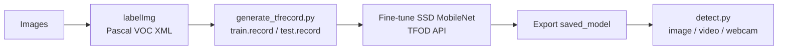

# Custom Object Detection with TensorFlow Object Detection API

Fine-tuning a pretrained **SSD MobileNet V2 FPNLite (320x320)** from the TF2 Model Zoo on a custom dataset, then running it on images, video and a live webcam.

SSD MobileNet was chosen because it is light enough to run in real time on a normal laptop, which matters more here than squeezing out the last bit of accuracy.

## Pipeline



## Project structure

```
.
├── tfod_training.ipynb     # end-to-end walkthrough: data checks, training, export, inference
├── generate_tfrecord.py    # labelImg XML -> TFRecord
├── detect.py               # inference on image / video / webcam
├── utils.py                # label map helpers + box drawing
├── requirements.txt
└── data/
    ├── label_map.pbtxt
    └── images/
        ├── train/          # images + XML annotations (~80%)
        └── test/           # images + XML annotations (~20%)
```

## Setup

```bash
pip install -r requirements.txt
```

The TFOD API itself is installed from the TensorFlow `models` repo (see section 3 of the notebook). Training is slow on CPU, so I used a GPU runtime (Colab works fine).

## Usage

**1. Prepare data.** Label images with [labelImg](https://github.com/HumanSignal/labelImg) and split them into `data/images/train` and `data/images/test`.

**2. Train.** Open `tfod_training.ipynb` and run it top to bottom. Change `CLASSES` in the first cell to match your dataset.

**3. Detect.**

```bash
python detect.py --source test.jpg      # single image, saved to outputs/
python detect.py --source video.mp4     # video file
python detect.py --source 0             # webcam, press q to quit
```

## Results

Add a screenshot of a detection here, for example `assets/sample_detection.png`.

| Model | Input size | Steps | Batch size |
|-------|-----------|-------|------------|
| SSD MobileNet V2 FPNLite | 320x320 | 3000 | 4 |

## Things I'd improve

- Collect more varied images (lighting, angles, backgrounds); data quality moves the needle more than tuning
- Add data augmentation in `pipeline.config`
- Convert to TFLite for edge deployment
- Try a larger backbone and compare mAP against FPS
